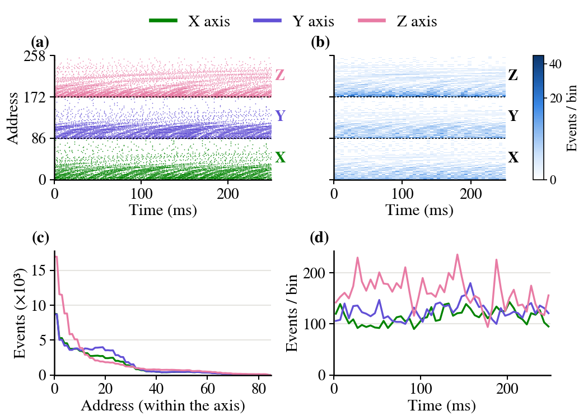
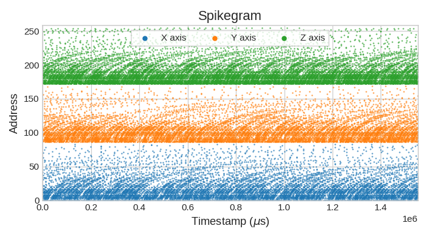
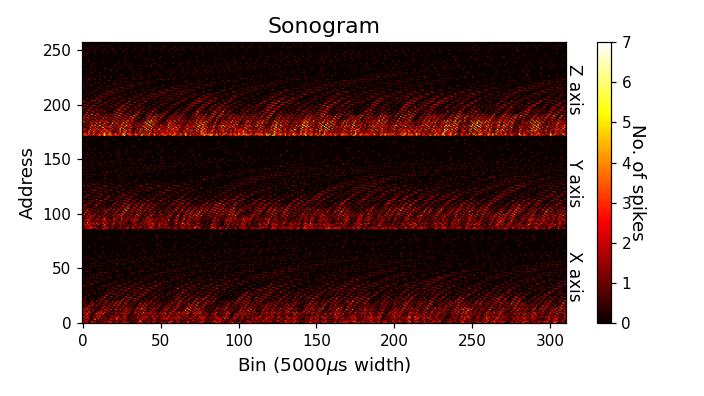
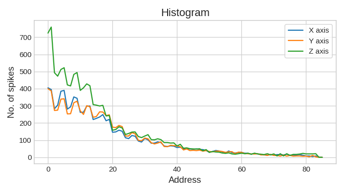
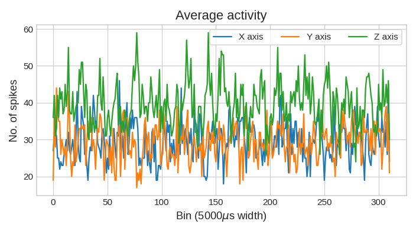
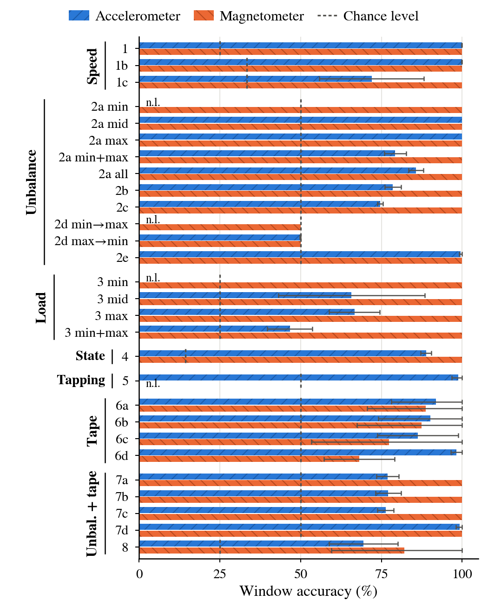

## pyNTAVIS: an open-source cross-platform Neuromorphic Tri-axial and Auditory VISualizer

<p>
<a href="http://www.gnu.org/licenses/gpl-3.0"></a>
</p>

<p align="justify">
pyNTAVIS is a fork of <a href="https://github.com/jpdominguez/pyNAVIS">pyNAVIS</a> that adds support for the tri-axial (X, Y, Z) spike streams of the <b>Neuromorphic Tri-Axial Sensor (NTAS)</b>, an FPGA-based front-end that converts the data of a MEMS accelerometer or magnetometer into address-event representation (AER) spikes. Everything pyNAVIS does for mono and stereo neuromorphic auditory sensors (NAS) still works, and the same functions now also accept three-axis files. The fork also adds tools to train spiking neural networks (SNNs) on AER recordings, used to validate the NTAS-Fan dataset.
</p>

<p align="center">
<br>
<i>NTAS accelerometer recording of a PC fan (NTAS-Fan dataset): (a) spikegram and (b) sonogram of a 0.25 s excerpt, (c) events per address of each axis, (d) activity of each axis in 5 ms bins.</i>
</p>


<h2>What is different from pyNAVIS</h2>

| | pyNAVIS | pyNTAVIS |
|---|---|---|
| Sensors | NAS (mono or stereo cochlea) | NAS, plus NTAS (tri-axial accelerometer or magnetometer) |
| `MainSettings.mono_stereo` | 0 (mono), 1 (stereo) | 0, 1, or `MainSettings.THREE_AXIS` (2) |
| Address layout | one block per cochlea | one block of `num_channels * (on_off_both + 1)` addresses per source, in X, Y, Z order |
| Plots (spikegram, sonogram, histogram, average activity) | left / right cochlea | one series and label per source, so X, Y and Z appear separately |
| `Functions.stereo_to_mono` | extracts the left or right cochlea | also extracts the X, Y or Z axis (`left_right = 0, 1, 2`) |
| SNN tools | — | `Splitters.window_splitter` (fixed-length windows with optional overlap) and `Functions.spikes_to_frames` (time-step × address count matrices for snnTorch, SpikingJelly or Norse) |
| Examples | NAS tutorials | three-axis tutorial, SNN training notebook, Fan NTAS experiment scripts |

<p align="justify">
New helper properties in <code>MainSettings</code>: <code>num_sources</code>, <code>addresses_per_source</code> and <code>source_labels</code>. Existing mono and stereo code keeps working unchanged; the only visible change is that <code>Plots.average_activity</code> returns one array per source followed by the figure, which for mono and stereo files is the same as before.
</p>


<h2>Tri-axial examples</h2>

<p align="justify">
The figures below were made with the plain pyNTAVIS functions on the example file
<a href="src/examples/test_files/NTAS_Accel_3Axxis_43ch_ONOFF_addr4b_ts1.aedat"><code>NTAS_Accel_3Axxis_43ch_ONOFF_addr4b_ts1.aedat</code></a>
(NTAS accelerometer, 43-channel slots per axis, ON/OFF polarities, 4-byte addresses, 1 µs tick):
</p>

<p align="center">
 <br>
 
</p>

```python
from pyNAVIS import *

settings = MainSettings(num_channels=43, mono_stereo=MainSettings.THREE_AXIS, on_off_both=1,
                        address_size=4, ts_tick=1, bin_size=5000)
spikes = Loaders.loadAEDAT('src/examples/test_files/NTAS_Accel_3Axxis_43ch_ONOFF_addr4b_ts1.aedat', settings)
Functions.adapt_timestamps(spikes, settings)

Plots.spikegram(spikes, settings)
Plots.sonogram(spikes, settings)
Plots.histogram(spikes, settings)
x_activity, y_activity, z_activity, fig = Plots.average_activity(spikes, settings)
z_axis = Functions.stereo_to_mono(spikes, left_right=2, settings=settings)   # Z axis as a mono file
```

<p align="justify">
<b>NTAS address mapping.</b> Each axis uses a 43-channel slot with ON and OFF polarities, so an event address is
<code>A = 86·s + 2·c + p</code>, where <code>s</code> = 0, 1, 2 is the axis (X, Y, Z), <code>c</code> = 0…41 is the channel and
<code>p</code> = 0 (ON) or 1 (OFF). The last slot position (<code>c</code> = 42) is never used, so only 252 addresses occur, all within 8 bits
(0–255). Lower channel indices correspond to higher frequencies.
</p>


<h2>Notebooks and scripts</h2>

| | Open | Description |
|---|---|---|
| [Three-axis AEDAT tutorial](src/examples/pyNTAVIS_3_axis_aedats_Tutorial.ipynb) | [](https://colab.research.google.com/github/juamonsan/pyNTAVIS/blob/master/src/examples/pyNTAVIS_3_axis_aedats_Tutorial.ipynb) | Load an NTAS file, plot it and split it into X, Y and Z |
| [SNN training with snnTorch](src/examples/pyNTAVIS_SNN_training_snnTorch.ipynb) | [](https://colab.research.google.com/github/juamonsan/pyNTAVIS/blob/master/src/examples/pyNTAVIS_SNN_training_snnTorch.ipynb) | Window the recordings, build frames, train and evaluate an SNN, and run the 4-fold cross-validation of the Fan NTAS experiments |
| [Original pyNAVIS tutorial](src/examples/pyNAVIS_Tutorial_WS.ipynb) | | NAS (mono and stereo) tutorial from pyNAVIS |

Scripts for the NTAS-Fan experiments (in [`src/examples`](src/examples)):

| Script | Purpose |
|---|---|
| [`fan_dataset.py`](src/examples/fan_dataset.py) | Parses the dataset file names and defines the experiments and their 4 folds |
| [`run_all_experiments.py`](src/examples/run_all_experiments.py) | Runs the cross-validation of all experiments and saves the results and figures |
| [`run_baseline.py`](src/examples/run_baseline.py) | Non-spiking baseline (logistic regression) with the same windows and folds |
| [`run_rate_only.py`](src/examples/run_rate_only.py), [`run_rate_normalized.py`](src/examples/run_rate_normalized.py) | Event-rate-only checks and data-rate figures |
| [`plot_paper_figures.py`](src/examples/plot_paper_figures.py), [`plot_paper_signal_examples.py`](src/examples/plot_paper_signal_examples.py) | Figures of the NTAS-Fan paper |
| [`load_three_axis_AEDAT.py`](src/examples/load_three_axis_AEDAT.py) | Minimal three-axis example |


<h2>NTAS-Fan dataset</h2>

<p align="justify">
NTAS-Fan contains 581 AER recordings (5–5.6 s each) of a 120 mm PC cooling fan with magnets on its blades, recorded with the NTAS using either an accelerometer (289) or a magnetometer (292), at three speeds and stopped, with balanced and unbalanced loads, and with external (tapping) and internal (tape touching the blades) mechanical noise.
</p>

<p align="justify">
<b>Download:</b> <a href="PENDING">idUS – Depósito de Investigación de la Universidad de Sevilla (DOI pending)</a>. The dataset is not stored in this repository: to run the notebooks or scripts with it, place the <code>Fan_NTAS_Dataset</code> folder in <code>src/examples/snn_dataset/</code> (this folder is ignored by git).
</p>

<p align="center">
<br>
<i>SNN window accuracy of all experiments (mean and standard deviation over 4 folds).</i>
</p>


<h2>Installing</h2>

<p align="justify">
pyNTAVIS is installed from this repository; it keeps the package name <code>pyNAVIS</code>, so <b>uninstall the PyPI pyNAVIS first</b>, as it does not support three-axis files:
</p>

```
pip uninstall -y pyNAVIS
git clone https://github.com/juamonsan/pyNTAVIS.git
cd pyNTAVIS/src
pip install -e .
pip install torch snntorch        # only for the SNN notebook and scripts
```

<p align="justify">
In Google Colab, the first cell of each notebook does this automatically. The general pyNAVIS documentation is at <a href="https://pynavis.readthedocs.io/en/latest/">ReadTheDocs</a>; it does not cover the three-axis additions, which are documented in the docstrings and the notebooks.
</p>


<h2 name="Cite">Cite this work</h2>

<p align="justify">If you use the three-axis functions or the NTAS-Fan dataset, please cite:</p>

```bibtex
@inproceedings{montes2026NTAS,
  title={Introducing the Neuromorphic Tri-Axial Sensor (NTAS)},
  author={Montes-S{\'a}nchez, Juan Manuel and D{\'i}az-Romero, Santiago and R{\'i}os-Navarro, Antonio and Vicente-D{\'i}az, Saturnino and Linares-Barranco, Alejandro and Jim{\'e}nez-Fern{\'a}ndez, {\'A}ngel},
  booktitle={2026 IEEE Asia Pacific Conference on Circuits and Systems (APCCAS)},
  year={2026}
}

@misc{DatasetNTAS2026,
  title={Dataset of AER data files of a cooling fan in several configurations recorded with the Neuromorphic Tri-Axial Sensor (NTAS-Fan)},
  author={Montes-S{\'a}nchez, Juan Manuel and Segawa, Taishi and Nagazawa, Ryuji and Uwate, Yoko and Vicente-D{\'i}az, Saturnino and Jim{\'e}nez-Fern{\'a}ndez, {\'A}ngel},
  howpublished={idUS (Dep{\'o}sito de Investigaci{\'o}n de la Universidad de Sevilla)},
  year={2026},
  note={DOI pending}
}
```

<p align="justify">and the original pyNAVIS paper:</p>

```bibtex
@article{dominguez2021pynavis,
  title={pyNAVIS: An open-source cross-platform software for spike-based neuromorphic audio information processing},
  author={Dominguez-Morales, Juan P and Gutierrez-Galan, D and Rios-Navarro, A and Duran-Lopez, L and Dominguez-Morales, M and Jimenez-Fernandez, A},
  journal={Neurocomputing},
  volume={449},
  pages={172--175},
  year={2021},
  publisher={Elsevier}
}
```


<h2>Contributing</h2>

<p align="justify">
Issues and pull requests for the three-axis additions are welcome in <a href="https://github.com/juamonsan/pyNTAVIS">this repository</a>. Changes that also apply to mono and stereo NAS files may be better proposed to <a href="https://github.com/jpdominguez/pyNAVIS">pyNAVIS</a>.
</p>


<h2>License</h2>

<p align="justify">
This project is licensed under the GPL License, like pyNAVIS - see the <a href="LICENSE">LICENSE</a> file for details.
</p>

<p align="justify">
pyNAVIS: Copyright © 2018 Juan P. Dominguez-Morales (<a href="mailto:jpdominguez@atc.us.es">jpdominguez@atc.us.es</a>).<br>
Three-axis additions: Copyright © 2026 Juan M. Montes-Sánchez (<a href="mailto:juanmanuelmontes@us.es">juanmanuelmontes@us.es</a>).
</p>
