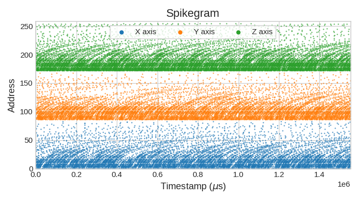
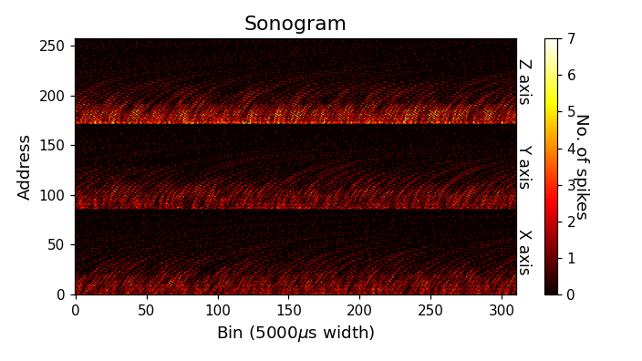
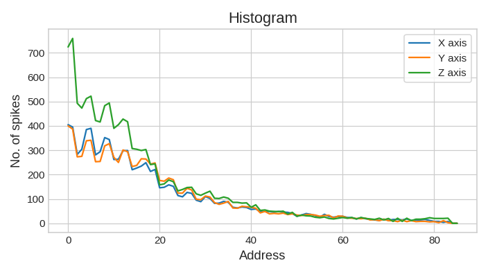
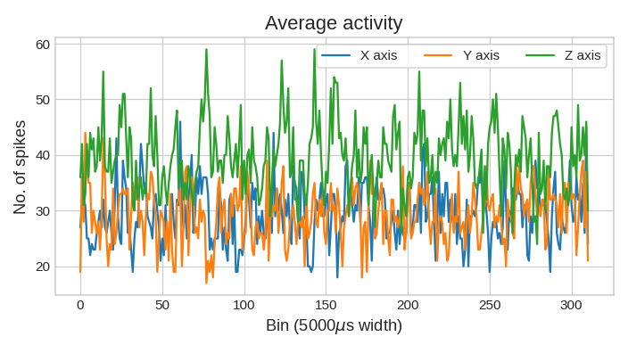

*************************************
Load and plot three-axis (NTAS) files
*************************************

Besides mono (**mono_stereo=0**) and stereo (**mono_stereo=1**) files, ``pyNTAVIS`` supports three-axis files
(**mono_stereo=2**, also available as ``MainSettings.THREE_AXIS``), such as those recorded with the Neuromorphic
Tri-Axial Sensor (NTAS) from a MEMS accelerometer or magnetometer.

1. Address layout
#################

The addresses of each source are stored in consecutive blocks of ``num_channels*(on_off_both+1)`` addresses: first the
X axis, then the Y axis and finally the Z axis. The number of sources and the size of each block are available as
``settings.num_sources`` and ``settings.addresses_per_source``, and their names as ``settings.source_labels``.

In the NTAS recordings, each axis has 42 active channels with ON and OFF polarities, placed in a 43-channel slot, so
**num_channels** is set to 43 and the address of an event is

.. math::

   A = 86\,s + 2\,c + p

where :math:`s \in \{0, 1, 2\}` is the axis (X, Y, Z), :math:`c \in \{0, \dots, 41\}` is the channel and
:math:`p \in \{0, 1\}` is the polarity (ON, OFF). Lower channel indices correspond to higher frequencies. The last slot
position (:math:`c = 42`) is never used: its addresses (84, 85, 170 and 171; 256 and 257 for Z) never occur, so only 252
addresses are used, all within 8 bits (:math:`A \le 255`).

2. Load and plot a three-axis file
##################################

The repository includes an example file, ``src/examples/test_files/NTAS_Accel_3Axxis_43ch_ONOFF_addr4b_ts1.aedat``: a
1.55 s NTAS accelerometer recording saved by jAER, with 4-byte addresses (**address_size=4**) and a 1 µs tick
(**ts_tick=1**).

.. prompt:: python \

    from pyNTAVIS import *
    settings = MainSettings(num_channels=43, mono_stereo=MainSettings.THREE_AXIS, on_off_both=1, address_size=4, ts_tick=1, bin_size=5000)
    three_axis_file = Loaders.loadAEDAT('src/examples/test_files/NTAS_Accel_3Axxis_43ch_ONOFF_addr4b_ts1.aedat', settings)
    Functions.adapt_timestamps(three_axis_file, settings)

    Plots.spikegram(three_axis_file, settings)
    Plots.sonogram(three_axis_file, settings)
    Plots.histogram(three_axis_file, settings)
    x_activity, y_activity, z_activity, avg_fig = Plots.average_activity(three_axis_file, settings)

Every plot shows the three axes separately, with one color and label per axis:

.. note::
    ``Plots.average_activity()`` returns one activity array per source (one for mono, two for stereo, three for
    three-axis files), followed by the figure.

.. note::
    ``Plots.difference_between_LR()`` is only available for stereo files.

3. Extract one axis
###################

A single axis can be extracted as a mono file with ``stereo_to_mono()``, setting **left_right** to 0, 1 or 2 for the
X, Y or Z axis:

.. prompt:: python \

    z_file = Functions.stereo_to_mono(three_axis_file, left_right=2, settings=settings, return_save_both=0)
    mono_settings = MainSettings(num_channels=43, mono_stereo=MainSettings.MONO, on_off_both=1, address_size=4, ts_tick=1, bin_size=5000)
    Plots.spikegram(z_file, mono_settings, graph_title='Spikegram - Z axis')

The addresses of the extracted axis start at 0, so it is plotted with mono settings.

.. note::
    The `three-axis tutorial notebook <https://github.com/juamonsan/pyNTAVIS/blob/master/src/examples/pyNTAVIS_3_axis_aedats_Tutorial.ipynb>`_
    runs all these steps, and can be opened in Google Colab.
