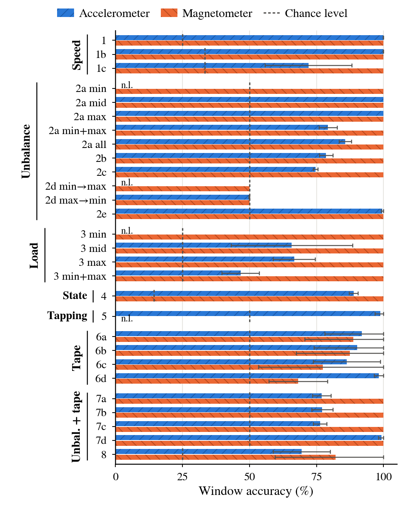

****************
NTAS-Fan dataset
****************

NTAS-Fan is a public dataset of AER recordings of a PC cooling fan acquired with the Neuromorphic Tri-Axial Sensor
(NTAS), for neuromorphic predictive maintenance research. It was validated with the SNN tools of ``pyNTAVIS`` (see the
:doc:`SNN example <Examples/snn_frames>`).

.. note::
   **Download:** idUS – Depósito de Investigación de la Universidad de Sevilla (DOI pending). The dataset is not stored
   in the GitHub repository.

Contents
========

- **581 recordings** of 5–5.6 s each: 289 with the accelerometer and 292 with the magnetometer (each recording
  contains only one sensor).
- A 120 mm, 12 V DC PC fan with neodymium magnets on three of its nine blades, at three speeds (about 12.5, 24.9 and
  31 Hz, i.e. 750–1860 RPM) and stopped.
- **Loads:** 3 magnets (balanced base configuration), 4 or 5 (unbalanced) and 6 (balanced, higher load).
- **External noise:** tapping the table with two fingers, about 10 cm from the fan.
- **Internal noise:** a piece of electrical tape attached to the frame, touching the blades as they pass.
- 112 combinations of speed, tape, tapping, sensor and load, each recorded 4 to 6 times, on five days in October 2026
  at Tokushima University, Japan.

The recordings are AEDAT 2.0 files (8 bytes per event: a 32-bit address and a 32-bit timestamp with a 1 µs tick). Their
addresses follow the NTAS layout described in the :doc:`three-axis example <Examples/three_axis>` (43-channel slots,
ON and OFF polarities, 252 addresses used).

File naming and metadata
========================

File names follow the convention ``<sample>_<speed>_<sensor>_<magnets>_<external>_<internal>.aedat``, for example
``0331_3_Accel_5_No_Yes.aedat``:

=============== ===========================================================================
Field           Values
=============== ===========================================================================
``sample``      Sample number of the recording (four digits).
``speed``       0 (stop), 1 (minimum), 2 (medium) or 3 (maximum).
``sensor``      ``Accel`` (accelerometer) or ``Mag`` (magnetometer).
``magnets``     3 (balanced), 4 and 5 (unbalanced) or 6 (balanced, higher load).
``external``    ``Yes`` or ``No``: external noise (tapping on the table).
``internal``    ``Yes`` or ``No``: internal noise (tape touching the blades).
=============== ===========================================================================

The metadata of every recording is also listed in ``Class_Table.csv`` (columns: Sample number, Fan Speed, Sensor,
Magnets/Weight, External Noise, Internal Noise, Date), which also gives the recording date.

Settings
========

.. prompt:: python \

    from pyNTAVIS import *
    settings = MainSettings(num_channels=43, mono_stereo=MainSettings.THREE_AXIS, on_off_both=1, address_size=4, ts_tick=1)
    recording = Loaders.loadAEDAT('Fan_NTAS_Dataset/0331_3_Accel_5_No_Yes.aedat', settings)

Using it with the examples
==========================

To run the SNN notebook or the experiment scripts of the repository with the dataset, place the ``Fan_NTAS_Dataset``
folder in ``src/examples/snn_dataset/`` (this folder is ignored by git). The scripts in ``src/examples`` are:

=================================================== ===============================================================================
Script                                              Purpose
=================================================== ===============================================================================
``fan_dataset.py``                                  Parses the file names and ``Class_Table.csv``, and defines the experiments and their 4 folds.
``run_all_experiments.py``                          Runs the cross-validation of all the experiments and saves the results and figures.
``run_baseline.py``                                 Non-spiking baseline (logistic regression) with the same windows and folds.
``run_rate_only.py``, ``run_rate_normalized.py``    Event-rate-only classifiers and AER data rates.
``plot_paper_figures.py``                           Figures of the experiment results.
``plot_paper_signal_examples.py``                   Views of one recording (spikegram, sonogram, histogram, average activity).
=================================================== ===============================================================================

*SNN window accuracy of all the NTAS-Fan experiments (mean and standard deviation over 4 folds).*
