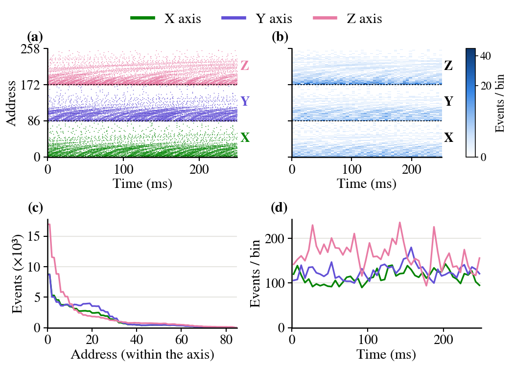

*********
pyNTAVIS
*********

.. image:: https://img.shields.io/badge/License-GPL%20v3-blue.svg
   :target: https://www.gnu.org/licenses/gpl-3.0
   :alt: License

``pyNTAVIS`` (Neuromorphic Tri-axial and Auditory VISualizer) is an open-source cross-platform Python module for analyzing and processing spiking information obtained from neuromorphic sensors. It is a fork of pyNAVIS_, which was designed for neuromorphic auditory sensors such as the NAS_, and adds support for the tri-axial (X, Y, Z) spike streams of the **Neuromorphic Tri-Axial Sensor (NTAS)**, an FPGA-based front-end that converts the data of a MEMS accelerometer or magnetometer into address-event representation (AER) spikes.

Everything pyNAVIS does for mono and stereo cochlea files still works, and the same functions also accept three-axis files. pyNTAVIS also adds tools to prepare AER recordings for spiking neural networks (SNNs), which were used to validate the :doc:`NTAS-Fan dataset <NTAS_Fan_dataset>`.

*NTAS accelerometer recording of a PC fan (NTAS-Fan dataset): (a) spikegram and (b) sonogram of a 0.25 s excerpt, (c) events per address of each axis, (d) activity of each axis in 5 ms bins.*

For more information, head over to the `GitHub repository <https://github.com/juamonsan/pyNTAVIS>`_.

.. _pyNAVIS: https://github.com/jpdominguez/pyNAVIS
.. _NAS: https://github.com/RTC-research-group/OpenNAS

What is different from pyNAVIS
==============================

=============================================================== ================================= ==============================================================================================
\                                                               pyNAVIS                           pyNTAVIS
=============================================================== ================================= ==============================================================================================
Package name                                                    ``import pyNAVIS``                ``import pyNTAVIS`` (both can be installed side by side)
Sensors                                                         NAS (mono or stereo cochlea)      NAS, plus NTAS (tri-axial accelerometer or magnetometer)
``MainSettings.mono_stereo``                                    0 (mono), 1 (stereo)              0, 1, or ``MainSettings.THREE_AXIS`` (2)
Plots (spikegram, sonogram, histogram, average activity)        left / right cochlea              one series and label per source, so X, Y and Z appear separately
``Functions.stereo_to_mono``                                    left or right cochlea             also the X, Y or Z axis (``left_right`` = 0, 1, 2)
SNN tools                                                       \-                                ``Splitters.window_splitter`` and ``Functions.spikes_to_frames``
=============================================================== ================================= ==============================================================================================

See the :doc:`three-axis example <Examples/three_axis>` and the :doc:`SNN example <Examples/snn_frames>` for details.

Installing
==========

``pyNTAVIS`` is installed from its GitHub repository:

.. prompt:: bash $

   git clone https://github.com/juamonsan/pyNTAVIS.git
   cd pyNTAVIS/src
   pip install -e .

For more information, head over to the :doc:`Installing section <Installing>`.

Getting started
===============

Now that you have everything set up, you can create a new Python file and import the package:

.. prompt:: python \

   from pyNTAVIS import *

With this, you can now use all the functionalities that ``pyNTAVIS`` provides. A more detailed guide with examples can be read :doc:`here <Getting started>`.

Software package
================

The Python code has been documented using docstrings, which is very convenient for users that want to either use
the software or develop new features and functionalities.

To see all the information for the different Python modules, classes, methods and all the possible configuration
options, read the :doc:`pyNTAVIS package section <pyNTAVIS>`.

Contributing
============

If you would like to help improve ``pyNTAVIS``, please read our :doc:`contributing guide <Contributing>`.

License
=======

This project is licensed under the GPL License, like pyNAVIS - see the `LICENSE file <https://github.com/juamonsan/pyNTAVIS/blob/master/LICENSE>`__ for details.

pyNAVIS: Copyright © 2018 Juan P. Dominguez-Morales (jpdominguez@atc.us.es). Three-axis additions: Copyright © 2026 Juan M. Montes-Sánchez (juanmanuelmontes@us.es).

Cite this work
==============

If you use the three-axis functions or the NTAS-Fan dataset, please cite the NTAS paper and the dataset:

``NTAS`` Montes-Sánchez, J. M., Díaz-Romero, S., Ríos-Navarro, A., Vicente-Díaz, S., Linares-Barranco, A., & Jiménez-Fernández, Á. (2026). Introducing the Neuromorphic Tri-Axial Sensor (NTAS). 2026 IEEE Asia Pacific Conference on Circuits and Systems (APCCAS).

``NTAS-Fan dataset`` Montes-Sánchez, J. M., Segawa, T., Nagazawa, R., Uwate, Y., Vicente-Díaz, S., & Jiménez-Fernández, Á. (2026). Dataset of AER data files of a cooling fan in several configurations recorded with the Neuromorphic Tri-Axial Sensor (NTAS-Fan). idUS (Depósito de Investigación de la Universidad de Sevilla). https://doi.org/10.12795/11441/191328

and the original pyNAVIS paper:

``APA`` Dominguez-Morales, J. P., Gutierrez-Galan, D., Rios-Navarro, A., Duran-Lopez, L., Dominguez-Morales, M., & Jimenez-Fernandez, A. (2021). pyNAVIS: An open-source cross-platform software for spike-based neuromorphic audio information processing. Neurocomputing, 449, 172-175.

``ISO 690`` DOMINGUEZ-MORALES, Juan P., et al. pyNAVIS: An open-source cross-platform software for spike-based neuromorphic audio information processing. Neurocomputing, 2021, vol. 449, p. 172-175.

``MLA`` Dominguez-Morales, Juan P., et al. "pyNAVIS: An open-source cross-platform software for spike-based neuromorphic audio information processing." Neurocomputing 449 (2021): 172-175.

``BibTeX`` @article{dominguez2021pynavis, title={pyNAVIS: An open-source cross-platform software for spike-based neuromorphic audio information processing}, author={Dominguez-Morales, Juan P and Gutierrez-Galan, D and Rios-Navarro, A and Duran-Lopez, L and Dominguez-Morales, M and Jimenez-Fernandez, A}, journal={Neurocomputing}, volume={449}, pages={172--175}, year={2021}, publisher={Elsevier} }
